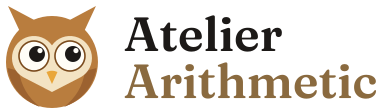

# Atelier Arithmetic — Logo

**Archie the Owl** (the mark) speaks to children; the **Fraunces** wordmark in ink and bronze speaks to
parents. The colours are the app's own (warm editorial, not "kiddie" — [design.md](../docs/design.md) §1–§3),
and Archie's amber matches the Archie drawn in the app (`MascotPainter`).

## Files

| File | Use it for |
|---|---|
| `logo-stacked.svg` | **Primary logo** — website header, report cover, About/Help, print |
| `logo-stacked-dark.svg` | The same on dark backgrounds (graphite `#18181C` or darker) |
| `logo-wide.svg` · `logo-wide-dark.svg` | One line, for short spaces (report header, email signature, store banner) |
| `archie-mark.svg` | Archie alone, when the name is already close by (in-app headers, social avatar, favicon ≥ 32 px) |
| `app-icon.svg` | App icon, **48 px and up**: installer, Start menu, `.ico` 48–256, macOS `.icns` |
| `app-icon-small.svg` | App icon simplified for **16–32 px** (title bar, taskbar, `.ico` 16/24/32): bigger eyes, no fine detail |

All files are plain SVG with the text already turned into shapes, so they look the same everywhere and need
no font installed.

## Colours

| Role | Hex |
|---|---|
| Ink — "Atelier", icon tile, pupils | `#1C1917` |
| Cream — "Atelier" on dark | `#FAF9F6` |
| Deep bronze — "Arithmetic" on light (≈ 5 : 1 on cream, WCAG AA) | `#8A6A3F` |
| Gold — "Arithmetic" on dark | `#DCB973` |
| Archie amber / shade | `#B97D3E` / `#9C6230` |
| Face · eyes · eye rims · beak | `#F3E3C3` · `#FFFDF7` · `#7A4A1C` · `#E9A63A` |

## Typeface

**Fraunces SemiBold (600)** — © The Fraunces Project Authors, SIL Open Font License 1.1, which allows use in
logos. Fraunces may also be used for large headlines next to the logo (website, report covers); the app's UI
fonts are unchanged.

## Rules

* **Clear space:** keep at least a quarter of Archie's height free on every side.
* **Minimum size:** stacked logo 120 px wide (30 mm in print), wide logo 160 px, mark 24 px. Below 48 px use
  `app-icon-small.svg` for the icon.
* **Backgrounds:** light → the normal files; dark → the `-dark` files. Never put a light version on a dark
  background or the other way round.
* **Don't** recolour Archie, stretch or rotate the logo, add shadows or outlines, swap the typeface, move the
  mark and the name apart, or place the logo on a busy photo.

## Status in the app

The app still uses the old blue owl `src/com/mathquiz/resources/logo.png` (a JPEG with a white background) for
the window icon, Help, Analytics and the exported report. Swing cannot draw SVG, so these files must first be
exported to PNG and ICO — task **DEBT-13** in [task.md](../docs/task.md).
