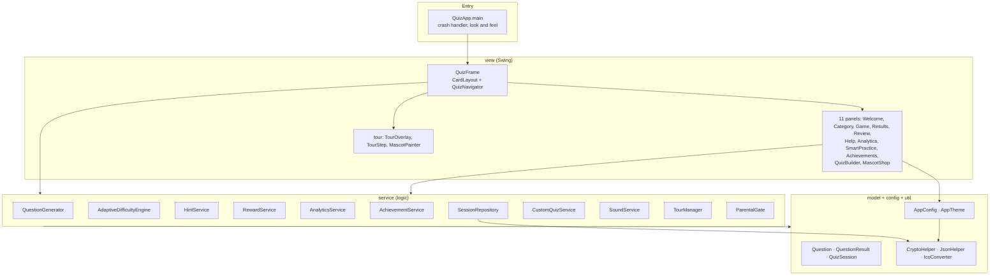
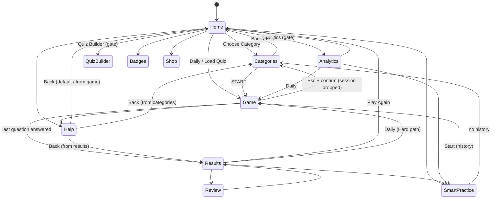
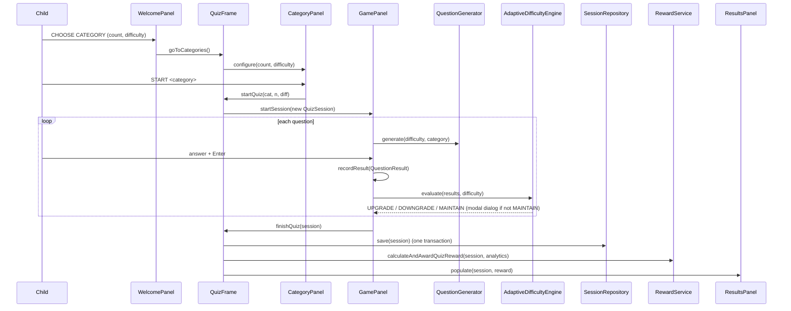

# Atelier Arithmetic — Architecture

| Field | Value |
|---|---|
| Document version | 1.0 |
| Date | 2026-11-08 |
| Baseline | Git `main` @ `aaed02c` (+ uncommitted one-line text change in `TourManager.java`) |
| Verified by | Reading every source file; `javac -encoding UTF-8 -cp "lib/*" -sourcepath src src/com/mathquiz/QuizApp.java` → exit 0, no warnings (JDK 21.0.1) |
| Related | [PRD.md](PRD.md) · [rules.md](rules.md) · [design.md](design.md) · [task.md](task.md) · [role_skills.md](role_skills.md) |

Line references (`File.java:NN`) are valid for the baseline above and will drift; search by method name when they do.

---

## 1. Purpose and scope

This document explains **how Atelier Arithmetic is built**: structure, runtime behaviour, data, security, build/release, and how to extend it. *What* the product must do is in [PRD.md](PRD.md); *how it must be written* is in [rules.md](rules.md).

## 2. Technology stack

| Concern | Choice | Version / detail |
|---|---|---|
| Language | Java | Source needs ≥ 9 (`InputStream.readAllBytes`); supported baseline JDK 17/21; built & run-verified here with **21.0.1** |
| UI | Swing / Java2D (custom painting) | System look-and-feel; no UI library |
| Persistence | SQLite via JDBC | `lib/sqlite-jdbc-3.42.0.0.jar` (13.0 MB, only third-party dependency) |
| Settings | Java `.properties`, AES-encrypted | `~/.atelier-arithmetic/config.properties` |
| Audio | `javax.sound.sampled` | Runtime-synthesised sine tones, no audio assets |
| Crypto | `javax.crypto` AES-128/ECB/PKCS5, SHA-256 | See [§8](#8-security-architecture) |
| Build | `javac` / `jar` scripts | No Maven/Gradle; `run.bat` (dev), `package.ps1` (release) |
| Packaging | `jlink` (via jpackage) + `jpackage` + WiX 3.11 | Bundled minimal JRE; MSI or portable ZIP |
| Signing | `signtool.exe` | SHA-256 + RFC 3161 timestamp |
| Tests | **none** | see DEBT-01 |
| Size | 36 Java files, ≈ 9,700 lines | |

## 3. System context

```
                ┌────────────────────────────────────────────────┐
  Child ───────►│                                                │
  Parent ──────►│   Atelier Arithmetic (single JVM process)      │
  Teacher ─────►│   Swing UI  +  services  +  local persistence  │
                └──────────────┬─────────────────────────────────┘
                               │ file I/O only (no network)
        ┌──────────────────────┼───────────────────────────────────────┐
        ▼                      ▼                      ▼                ▼
 config.properties   atelier_arithmetic.db   custom_quizzes/*.json   logs/error.log
        (all under  %USERPROFILE%\.atelier-arithmetic\ )                  + optional HTML report (user-chosen path)
                               │
                       Audio device (output only)    System print dialog (on export)
```

There are **no external services**. The only outbound network use in the whole repository is the timestamp URL inside `sign.ps1` (build tooling).

## 4. Layered architecture



### 4.1 Dependency direction (intended)
`view → service → model/config/util`. Views talk to each other **only through `QuizNavigator`**.

### 4.2 Known layering exceptions (current code)
| From | To | Why it is an exception |
|---|---|---|
| `config.AppTheme` | `service.SoundService` | `scaleComponentFont(…, SoundService)` attaches button sounds → config depends on service |
| `service.TourManager` | `view.tour.*`, `view.QuizNavigator` | Tour controller lives in `service` but drives view classes |
| `service.ParentalGate` | `javax.swing` | A dialog inside the service package |
| `service.SessionRepository` | `AppConfig.getInstance()` | Hidden dependency on global current-profile state |
| `view.WelcomePanel`, `AnalyticsPanel` | `new SessionRepository()`, `AnalyticsService`, `AchievementService` | Panels construct their own services instead of receiving the ones owned by `QuizFrame` |
| `view.*` | `AppConfig.getInstance()` | Several panels read/write config directly (Welcome, Results, Shop, Analytics) |

These are catalogued as DEBT-04/05 in [task.md](task.md); new code must not add to them ([rules.md](rules.md) R-ARC-*).

## 5. Source inventory

Root: `D:\MathQuizApp`. Source root: `src/com/mathquiz/`.

### 5.1 Repository files
| Path | Role |
|---|---|
| `README.md` | Public project description (corrected against the code on 2026-11-08; remaining code-level gaps are listed under *Known Limitations*) |
| `DEPLOYMENT.md` | Packaging, signing, silent-install and SmartScreen guidance |
| `run.bat` | Developer compile-and-run (`javac … -d bin`, copy resources, `java -cp "bin;lib/*" com.mathquiz.QuizApp`) |
| `package.ps1` | Release pipeline (compile → ICO → JAR → jpackage app-image → MSI or ZIP) |
| `sign.ps1` | Code-signing wrapper around `signtool.exe` |
| `lib/sqlite-jdbc-3.42.0.0.jar` | Committed dependency (the `.gitignore` allows `lib/*.jar`) |
| `src/com/mathquiz/resources/logo.png` | 1024×1024 brand image (**file content is JPEG** despite the `.png` name; `ImageIO` reads it by content) |
| `bin/`, `build/`, `dist/`, `logo.ico` | Generated, git-ignored |
| `.gitignore` | Ignores class files, build outputs, IDE files, logs |
| `docs/` | This documentation set |

### 5.2 Java classes
| Package | Class | LOC | Responsibility / key API |
|---|---|--:|---|
| `com.mathquiz` | `QuizApp` | 54 | `main`: installs default uncaught-exception handler (log + dialog), sets AA properties and system L&F, opens `QuizFrame` on the EDT |
| `config` | `AppConfig` | 234 | Singleton (`getInstance`) over an AES-encrypted `Properties` file; typed getters/setters for every setting (each setter saves immediately); `getAppDir()` = `~/.atelier-arithmetic` |
| `config` | `AppTheme` | 99 | Static light/dark palettes and semantic getters (`getBgPrimary/Card/TextDark/TextMuted/BorderClr/AccentGold`); `scaleComponentFont()` recursively scales fonts and attaches hover/click sounds to buttons |
| `model` | `Question` | 23 | Immutable expression + `int` answer |
| `model` | `QuestionResult` | 35 | Immutable per-answer record (expression, correct, user answer, correctness, ms) |
| `model` | `QuizSession` | 117 | Session state (count, difficulty (mutable), category, start time, results); percentage, **grade, remarks, emoji** rules |
| `service` | `QuestionGenerator` | 576 | `generate(difficulty, category)`, `generateSeeded(difficulty, category, dateSeed, index)`; one private generator per category |
| `service` | `AdaptiveDifficultyEngine` | 146 | `evaluate(results, difficulty)` → `UPGRADE/DOWNGRADE/MAINTAIN`; static `upgrade/downgrade/canUpgrade/canDowngrade` |
| `service` | `HintService` | 194 | Static `generateHint(expression)` → HTML string by pattern matching |
| `service` | `RewardService` | 168 | Star balance, shop unlock/equip delegation to `AppConfig`, `calculateAndAwardQuizReward()` → `RewardResult` |
| `service` | `AnalyticsService` | 434 | All aggregate stats over `SessionRepository.loadRaw()` (trend, per-category accuracy, streaks, weakest category/difficulty, heatmap, KPIs); `ALL_CATEGORIES` constant |
| `service` | `AchievementService` | 103 | Computes the 10 `Achievement`s from history |
| `service` | `SessionRepository` | 256 | JDBC access to SQLite: `save`, `loadRaw`, `getSessionCount`, `hasHistory`, `clear`; transparent column encryption |
| `service` | `CustomQuizService` | 84 | Save/load/list quiz JSON files |
| `service` | `SoundService` | 208 | 13 `playX()` methods generating PCM tones on new threads (4 are never called) |
| `service` | `TourManager` | 285 | Owns the 24 `TourStep`s, cursor, active flag; auto-navigates screens; persists `tourSeen` on completion |
| `service` | `ParentalGate` | 71 | Static `verifyParent(Component)` modal puzzle |
| `util` | `CryptoHelper` | 62 | Static `encrypt/decrypt` (Base64 AES) with static machine-derived key |
| `util` | `JsonHelper` | 192 | Minimal hand-written JSON writer/reader for a flat schema |
| `util` | `IcoConverter` | 98 | CLI tool: PNG/JPEG → 256×256 PNG-in-ICO (used by `package.ps1`) |
| `view` | `QuizNavigator` | 78 | Navigation contract (16 methods) |
| `view` | `QuizFrame` | 447 | JFrame; owns services & panels; implements `QuizNavigator`; theme/scale orchestration; tour wiring |
| `view` | `WelcomePanel` | 1142 | Home dashboard, profile menu/dialog, sound menu, theme & scale toggles, calendar strip, streak logic (duplicate) |
| `view` | `CategoryPanel` | 330 | 10 category cards, keyboard navigation |
| `view` | `GamePanel` | 563 | Quiz loop, timer, hint box, adaptive prompts, key bindings |
| `view` | `ResultsPanel` | 636 | 4-card results dashboard, HTML export, print |
| `view` | `ReviewPanel` | 268 | Colour-coded answer table |
| `view` | `HelpPanel` | 383 | 13 help sections (HTML body width pinned to 440 CSS px ≈ 572 px so the page fits the 720 px minimum window) |
| `view` | `AnalyticsPanel` | 844 | Dashboard + inner `LineChartPanel`, `RadarChartPanel` (Java2D) |
| `view` | `SmartPracticePanel` | 227 | Weakest-topic recommendation + launcher |
| `view` | `AchievementsPanel` | 198 | Badge grid |
| `view` | `QuizBuilderPanel` | 354 | Custom quiz editor |
| `view` | `MascotShopPanel` | 325 | 12-item catalogue (`ShopItem`, `ALL_ITEMS`), buy/equip |
| `view.tour` | `TourOverlay` | 268 | Glass pane: dimmed mask with spotlight hole, bubble, NEXT/SKIP |
| `view.tour` | `TourStep` | 63 | Step data (screen, target component, message, bubble position, mascot expression) |
| `view.tour` | `MascotPainter` | 170 | Draws Archie the Owl with Java2D (5 expressions) |

## 6. Runtime behaviour

### 6.1 Start-up sequence
1. `QuizApp.main` → `Thread.setDefaultUncaughtExceptionHandler(…)`; set `awt.useSystemAAFontSettings`, `swing.aatext`; `UIManager.setLookAndFeel(system)`.
2. `SwingUtilities.invokeLater` → `new QuizFrame()`; `setVisible(true)`.
3. `QuizFrame` field initialisers run first: `AppConfig.getInstance()` (reads + decrypts config), `new SessionRepository()` (creates app dir + tables), `AnalyticsService`, `SoundService`, `AchievementService`, `RewardService`.
4. Constructor: title/size/icon → `AppTheme.setDarkMode(config.isDarkMode())` → construct 11 panels (each performs its initial build; `WelcomePanel` already queries the DB) → register cards → show `welcome` → `invokeLater(updateAllThemes)`.
5. Glass pane `TourOverlay` + `TourManager`; build the component **registry** (`Map<String,Component>` of tour targets) → `tourManager.initialize(registry, onEnd)`.
6. If `!tourSeen`: Swing `Timer(400 ms, one-shot)` → `startTourForScreen("welcome")`.
7. `soundService.playLaunch()`.
8. `updateAllThemes()` (queued in step 4): re-theme all panels, apply font scale (default 1.25) and install button sounds, `updateComponentTreeUI`.

### 6.2 Object ownership
```
QuizFrame ── owns ──► AppConfig (singleton)           SessionRepository ─ uses ─► AppConfig.getInstance() (current profile)
                      SessionRepository ─► AnalyticsService ─► AchievementService
                      SoundService(config)   RewardService(config)
                      TourOverlay ─► TourManager(config, overlay, navigator=this)
          creates ──► 11 panels, each given the QuizNavigator (this) and the services it needs
GamePanel owns QuestionGenerator + AdaptiveDifficultyEngine; QuizBuilderPanel owns CustomQuizService
WelcomePanel / AnalyticsPanel additionally instantiate SessionRepository/AnalyticsService/AchievementService ad hoc (see §4.2)
```

### 6.3 Navigation model
`QuizFrame` holds one `CardLayout`. All transitions go through `QuizNavigator`:

| Method | Effect in `QuizFrame` |
|---|---|
| `goToWelcome()` | transition sound → show `welcome` → focus count field → `welcomePanel.refreshDynamicData()` → continue tour |
| `goToCategories()` | sound → `categoryPanel.configure(count, difficulty)` from Home → show `categories` → focus first card |
| `startQuiz(cat, n, diff)` | quiz-start sound → `lastSession = new QuizSession(n, diff, cat)` → `gamePanel.startSession` → show `game` |
| `finishQuiz(session)` | `null` ⇒ just show `results`. Else fanfare → (Daily: store date) → **`repository.save`** → `rewardService.calculateAndAwardQuizReward` → `resultsPanel.populate(session, reward)` → show `results` |
| `showReview(_)` | uses `lastSession` (parameter ignored) → `reviewPanel.populate` → show `review` |
| `showHelp(returnScreen)` | stores return card → show `help` |
| `showAnalytics()` | **gate** → `analyticsPanel.refresh()` → show |
| `startSmartPractice()` / `showAchievements()` / `showMascotShop()` | refresh panel → show |
| `startDailyChallenge()` | session `("Daily Challenge","Medium",10)` → `gamePanel.startSession` → show `game` |
| `startCustomQuiz(name, qs)` | session `(qs.size(),"Medium","Custom: "+name)` → `gamePanel.startSession(session, qs)` |
| `showQuizBuilder()` | **gate** → show |
| `launchTour()` | show `welcome` → `tourManager.startTourForScreen("welcome")` |
| `showCardForTour(screen)` | switch card directly (no sound); creates a **mock `QuizSession(10,"Medium","Mixed")`** for game/results/review if none exists |
| `resetAllData()` | clear current profile's sessions, zero global stars, clear that profile's shop data, refresh 5 panels |



### 6.4 Quiz lifecycle (sequence)


### 6.5 Game panel internals
* **State:** `activeSession`, `currentQuestion`, `questionStartTime`, `awaitingNext`, `customQuestions` (null for generated quizzes), `questionTimer` (1 s Swing timer).
* **Question source precedence:** custom list → Daily Challenge (seeded Mixed) → generator by session category/difficulty.
* **Submit state machine:** `awaitingNext=false` → validate → record → `awaitingNext=true` (button "NEXT QUESTION →") → next press → `loadNextQuestion()`.
* **Timer lifecycle defect:** started in `resetTimer()` (each question), stopped only in `handleSubmit()` and when the session ends. Leaving by Esc/Guide/tour does not stop it (BUG-03).
* **Key bindings** (`WHEN_IN_FOCUSED_WINDOW`): `Esc` (confirm exit), `F1` and `Ctrl+H` (hint).

### 6.6 Tour subsystem
```
TourManager (service)                    TourOverlay (glass pane, JPanel)               MascotPainter
  steps: List<TourStep> (24)  ─ showStep ─►  paint: dark mask (Area) − rounded spotlight    draws Archie, 5 expressions
  cursor, active                              + gold border + bubble + step counter
  startTourForScreen(screen)                  NEXT / SKIP buttons (absolute layout)
  nextStep / skipTour / endTour               consumes all other mouse events
        │ showCurrentStep() ─► navigator.showCardForTour(step.screen) (so the target is on screen)
```
* Targets are real component instances captured at `initialize()` time through the registry built in `QuizFrame` (e.g. `calendarStripHolder` rather than the rebuilt strip).
* `QuizFrame.maybeContinueTour(screen)` is called from navigation methods so a running tour can follow the user; it jumps to the **first** step of that screen.
* `endTour(completed)`: hides overlay; persists `tourSeen=true` **only if completed** (skip does not — BUG-09); runs the `onTourEnd` callback (`welcomePanel.applyTheme()`).

### 6.7 Theming and scaling
* `AppTheme` is a static holder (`darkMode`) with semantic getters. `QuizFrame.updateAllThemes()` is the single refresh point: set dark flag from config → call `applyTheme()` on all 11 panels → `AppTheme.scaleComponentFont(frame, config.getFontSizeScale(), sound)` → `SwingUtilities.updateComponentTreeUI` → `repaint`.
* It is invoked on start-up, theme toggle, scale toggle, profile switch, mute/volume change, and sound-preset change.
* Scaling stores each component's original size in client property `baseFontSize` and sets `round(base × scale)`; HTML label text with inline `font-size` is **not** scaled. Button sounds are attached once (client property `soundAttached`).
* Components created **after** the last `updateAllThemes()` (e.g. rebuilt badge cards, analytics cards, shop buttons) are not scaled/instrumented until the next call (BUG-14, to be verified visually).
* Each view still carries a private copy of the light palette as `static final Color` constants (design-token duplication — DEBT-05).

### 6.8 Audio
`SoundService` computes `volumeFactor = soundEnabled ? soundVolume/100 : 0` and returns early at 0. Every sound creates a **new `Thread`**; each tone opens a `SourceDataLine` (44.1 kHz, 8-bit, mono, signed, big-endian), writes a sine wave with a linear fade-out envelope, `drain()`s and closes; any exception is swallowed (so no audio device ⇒ silence, no error). Catalogue and frequencies: [design.md §11](design.md#11-audio-design).

## 7. Data architecture

All persisted data sits in `System.getProperty("user.home") + "/.atelier-arithmetic/"`.

```
.atelier-arithmetic/
├── config.properties        # one Base64 AES blob (entire Properties text)
├── atelier_arithmetic.db    # SQLite database
├── custom_quizzes/          # <sanitised-name>.json  (plaintext)
└── logs/error.log           # appended on uncaught exceptions
```
Uninstalling the app leaves this folder in place.

### 7.1 `config.properties` keys
| Key | Type | Default | Scope | Written by |
|---|---|---|---|---|
| `tourSeen` | bool | `false` | global | `TourManager.endTour(true)` |
| `soundEnabled` | bool | `true` | global | Sound menu |
| `soundVolume` | int 0–100 | `70` | global | Sound menu presets (100/75/50/25) |
| `darkMode` | bool | `false` | global | theme toggle |
| `fontSizeScale` | double | `1.25` | global | scale toggle (1.0 / 1.25 / 1.5) |
| `lastDailyChallengeDate` | `yyyyMMdd` | `""` | **global** | `QuizFrame.finishQuiz` |
| `currentProfile` | string | `Guest` | global | profile switch |
| `profiles` | comma-separated | `Guest` | global | `addProfile` |
| `starBalance` | int ≥ 0 | `0` | **global** | `RewardService` |
| `unlockedItems.<profile>` | comma-separated IDs | `""` | per profile | `addUnlockedItem` |
| `equippedItem.<profile>` | item ID or `none` | `none` | per profile | `setEquippedItem` |

Every setter calls `save()` (full rewrite). `load()` decrypts; if decryption throws or the file is plaintext, the raw text is parsed as properties (so a corrupt/foreign blob effectively yields defaults).

### 7.2 SQLite schema
```sql
CREATE TABLE IF NOT EXISTS sessions (
  id INTEGER PRIMARY KEY AUTOINCREMENT,
  profile_name TEXT NOT NULL,      -- AES(Base64)
  timestamp TEXT NOT NULL,         -- 'yyyy-MM-ddTHH:mm:ss' (session START, local time) — plaintext
  category TEXT NOT NULL,          -- AES(Base64)
  difficulty TEXT NOT NULL,        -- AES(Base64)  (value at completion)
  total_questions INTEGER NOT NULL,
  correct_answers INTEGER NOT NULL,
  percentage REAL NOT NULL,        -- rounded to 1 decimal
  grade TEXT NOT NULL,             -- AES(Base64)
  duration_ms INTEGER NOT NULL
);
CREATE TABLE IF NOT EXISTS session_questions (
  id INTEGER PRIMARY KEY AUTOINCREMENT,
  session_id INTEGER NOT NULL,
  expression TEXT NOT NULL,        -- AES(Base64)
  correct_answer INTEGER NOT NULL,
  user_answer INTEGER NOT NULL,
  correct INTEGER NOT NULL,        -- 0/1
  time_ms INTEGER NOT NULL,
  FOREIGN KEY (session_id) REFERENCES sessions(id) ON DELETE CASCADE
);
```
* No indexes, no `user_version`/migrations (schema evolution is currently impossible without manual SQL — DEBT-11).
* `PRAGMA foreign_keys = ON` is a per-connection setting; it is executed in `clear()` (the only path that relies on cascade). The pragma in `initDatabase()` affects only its throw-away connection.
* A new JDBC connection is opened for every public call (no pool).
* Profile filtering: `WHERE profile_name = ?` with the **encrypted** profile name. This works only because ECB encryption is deterministic.

`loadRaw()` returns `List<Map<String,Object>>`, newest first, each with `timestamp, category, difficulty, totalQuestions, correctAnswers, percentage, grade, durationMs, questions:[{expression, correctAnswer, userAnswer, correct, timeMs}]`. All analytics/achievement/streak code consumes this structure.

### 7.3 Custom quiz file
```json
[
  {
    "expression": "5 * 12 + 6",
    "answer": 66
  }
]
```
Written by `JsonHelper.buildSessionArray`; parsed by `splitArray` + `extractString/extractInt` using literal `"key": ` search (expects exactly the writer's formatting; no unescaping — BUG-10).

### 7.4 Derived data (not stored)
Achievements, streaks, heatmap, per-category accuracy, weakest category/difficulty, KPIs — all recomputed from `loadRaw()` on demand.

### 7.5 Performance characteristics (static analysis)
`loadRaw()` loads **all** sessions and, for each, a separate query for its questions, decrypting every encrypted field. It is called repeatedly: opening Analytics triggers ≈ 17 full loads; refreshing Home ≈ 5 (stats label ×3, streak, calendar) and Home refresh happens on every return to Home and every theme/scale/profile change. Everything runs on the EDT. Fine for tens of sessions; will degrade with hundreds (DEBT-03, DEBT-09).

## 8. Security architecture

### 8.1 Controls
| Control | Implementation |
|---|---|
| No network | No socket/URL code in `src/` |
| Encryption at rest | `CryptoHelper`: `AES/ECB/PKCS5Padding`, 128-bit key = first 16 bytes of `SHA-256(user.name + os.name + user.home)`, Base64 output. `encrypt` falls back to returning plaintext on error; `decrypt` returns input on error |
| SQL injection | All SQL uses `PreparedStatement` with bound parameters |
| Path traversal (custom quizzes) | File name restricted to `[A-Za-z0-9_-]` by `sanitizeFilename` |
| Parental gate | Random product puzzle; protects Analytics, Quiz Builder, Reset History, Sound menu |
| Crash containment | Default uncaught handler logs & informs |
| Privacy UX | Profile dialog warns against real names; mascot-name generator |

### 8.2 Honest limits
| Limit | Consequence |
|---|---|
| Key is derived from non-secret values | Anyone running as the same user (or knowing those three strings) can derive the key. Protection is **obfuscation against casual copying**, not confidentiality |
| ECB mode, no IV | Equal plaintexts → equal ciphertexts (leaks equality, e.g. which sessions share a category) — accepted because queries need equality on `profile_name` |
| Numeric/time columns and custom quizzes are plaintext | Scores, counts, timestamps readable |
| Machine/user binding | Restoring files under another Windows account (or after renaming the user/home) makes data unreadable |
| Gate strength | Product of two numbers in [3,12] (9–144) — deters children only |
| sqlite-jdbc native extraction | The driver extracts its native library to the temp directory at first use (standard behaviour of this driver) |
| HTML report | Expression/category are written unescaped (BUG-11) |
| Secrets in `sign.ps1` | `-Pin`/`-CertPassword` are plain command-line parameters (visible in shell history/process list) — REL-05 |

Upgrade path (AES-GCM + random per-install key in Windows DPAPI + HMAC blind index for profile lookup) is DEBT-08.

## 9. Concurrency model
* **EDT:** all Swing, all DB and file I/O, all analytics computation, `Timer` callbacks.
* **Sound threads:** one short-lived non-daemon thread per sound (JVM exits via `EXIT_ON_CLOSE` → `System.exit`).
* **Timers:** `GamePanel.questionTimer` (1 s), one-shot 400 ms tour starter.
* **Shared state:** `AppConfig` singleton is synchronised only in `getInstance()`; its `Properties` is accessed from the EDT in practice. `AdaptiveDifficultyEngine` and `QuestionGenerator` are single-threaded (EDT).

## 10. Error handling and logging
| Layer | Behaviour |
|---|---|
| Uncaught exceptions | Appended to `logs/error.log` (thread, timestamp, stack) + friendly dialog |
| `SessionRepository` | Catches `SQLException`, prints to `System.err`, **continues** — a failed save loses the session silently (the user still sees Results) |
| `AppConfig` | Catches `IOException`, prints to `System.err` |
| `SoundService` | Swallows all exceptions |
| `CustomQuizService`/`JsonHelper.writeFile` | `IOException` ignored → `saveQuiz` may return `true` even if the write failed |
| No log rotation, no log levels, no structured logging | |

## 11. Build, packaging and release

### 11.1 Developer loop — `run.bat`
```
mkdir bin
javac -cp "lib/*" -sourcepath src src\com\mathquiz\QuizApp.java -d bin      # no -encoding flag
xcopy /s /y /i src\com\mathquiz\resources bin\com\mathquiz\resources
java -cp "bin;lib/*" com.mathquiz.QuizApp                                   # ';' = Windows classpath separator
```
> On JDK < 18 under a non-UTF-8 Windows code page, source files with emoji literals can be mis-decoded without `-encoding UTF-8` (JDK 21 defaults to UTF-8). Add the flag (DEBT-02).

### 11.2 Release pipeline — `package.ps1`
| Step | Action |
|---|---|
| 1 | Verify `javac`, `jar`, `jpackage`; detect WiX (`candle.exe` + `light.exe`) |
| 2 | **Delete `build/` and `dist/`** (destroys previous outputs) |
| 3 | `javac` (`QuizApp` + `IcoConverter`) → `build/classes`; run `IcoConverter` → `logo.ico` (repo root); copy `logo.png` into classes |
| 4 | `jar --create --file dist/atelier-arithmetic.jar --main-class com.mathquiz.QuizApp -C build/classes .`; stage `build/input` with the app JAR + sqlite JAR |
| 5 | `jpackage --type app-image --name AtelierArithmetic --add-modules java.base,java.desktop,java.sql,java.xml,java.naming,jdk.charsets --jlink-options "--strip-debug --no-man-pages --no-header-files --compress zip-9" --icon logo.ico --app-version 1.0.0 --vendor "Atelier Arithmetic" --dest dist` → `dist/AtelierArithmetic/{AtelierArithmetic.exe, app/, runtime/}` |
| 6a | WiX present → `jpackage --type msi --win-menu --win-shortcut --win-dir-chooser --win-upgrade-uuid 71a2e7c3-3882-4df4-94fa-7e9b422a59cc --win-menu-group "Atelier Arithmetic"` → `dist/AtelierArithmetic-1.0.0.msi` |
| 6b | WiX absent → `Compress-Archive` → `dist/AtelierArithmetic-v1.0.0-Portable.zip` |

Observed outputs in this working copy (`dist/`): `atelier-arithmetic.jar` (451,766 B), `AtelierArithmetic/` app-image (launcher 463,872 B; runtime Java 21.0.1; modules: java.base, java.datatransfer, java.xml, java.prefs, java.desktop, java.logging, java.security.sasl, java.naming, java.transaction.xa, java.sql, jdk.charsets), `AtelierArithmetic-v1.0.0-Portable.zip` (46,470,444 B). **No MSI** is present (WiX was absent for the last build).

`1.0.0` is hard-coded in `package.ps1` (several places) and `HelpPanel` (REL-01).

### 11.3 Signing — `sign.ps1`
Parameters: `-TargetFile` (default `dist\AtelierArithmetic\AtelierArithmetic.exe`), `-CertPath/-CertPassword` (PFX), `-Pin/-ContainerName` (EV smart-card via "Microsoft Base Smart Card Crypto Provider"), `-CryptoProvider` (declared, unused). Locates `signtool.exe` under Windows Kits 10/8.1 (or `PATH`); signs with `/fd SHA256 /tr http://timestamp.digicert.com /td SHA256`; verifies with `signtool verify /pa`. Selection order: PFX → EV token (when `-Pin` given) → store auto-select (`/a`).
Recommended order for a fully signed release: sign the inner `AtelierArithmetic.exe`, build MSI, sign the MSI (REL-02).

## 12. Extension guide

| To add… | Touch these places (all required) |
|---|---|
| **A question category** | `QuestionGenerator.generate` switch + a private generator; `CategoryPanel` arrays `CATEGORIES/DESCRIPTIONS/ICONS` (the 3-col grid adapts); `AnalyticsService.ALL_CATEGORIES`; `AnalyticsPanel.CATEGORY_LABELS` and `CATEGORY_COLORS` (radar draws `CATEGORY_LABELS.length` spokes but reads values via `ALL_CATEGORIES` — keep both in the same order); `HintService` routing; `HelpPanel` text; tour text mentioning "10"; PRD §9 |
| **A difficulty-dependent template** | Add a sub-type in the category method, guarantee integer answer, add a generator invariant test (DEBT-01) |
| **An achievement** | Add a rule + `new Achievement(...)` in `AchievementService`; update hard-coded `"/ 10"` in `WelcomePanel` (two places) and the "10" in tour/help text |
| **A shop item** | Append to `MascotShopPanel.ALL_ITEMS` (unique `id`); no other code needed |
| **A setting** | Getter/setter with default in `AppConfig`; UI in `WelcomePanel`; document in §7.1 |
| **A screen** | `CARD_*` constant + panel construction + `mainPanel.add` in `QuizFrame`; `QuizNavigator` method + implementation; `applyTheme()` + entry in `updateAllThemes()`; tour registry entries if it has tour steps |
| **A tour step** | Register target in `QuizFrame` registry; add `TourStep` in `TourManager.initialize` (order = playback order) |
| **A sound** | New method in `SoundService` using `playTone/playToneSlide`; call from the relevant panel; document in design.md §11 |
| **A DB column** | Requires migration support first (DEBT-11) |

## 13. Architecture decisions (inferred from history and code)

| ID | Decision | Rationale (inferred) | Evidence |
|---|---|---|---|
| AD-01 | Pure Swing + Java2D, zero UI dependencies | Bundled in JDK; smallest footprint; single jlink runtime | `view/*`; `package.ps1` modules |
| AD-02 | Single-frame `CardLayout` with panels built once | Fast navigation, shared state, easy tour targeting | `QuizFrame` |
| AD-03 | `QuizNavigator` interface between panels and frame | Loose coupling, testability | `QuizNavigator.java` |
| AD-04 | Service layer for logic | Keep panels presentational | `service/*` (partly eroded, §4.2) |
| AD-05 | SQLite replaces JSON history | ACID writes, relational queries, cascade deletes | commit `f6be529` |
| AD-06 | Achievements derived from history | No extra state to corrupt; clearing history resets | `AchievementService` |
| AD-07 | Date-seeded Daily Challenge | Same quiz for everyone on a date, no server needed | `QuestionGenerator.generateSeeded` |
| AD-08 | Programmatic audio | No asset files, volume control, tiny size | `SoundService` |
| AD-09 | Hand-drawn charts & mascot | No chart/image dependencies; theme-aware | `AnalyticsPanel`, `MascotPainter` |
| AD-10 | Machine-bound AES for config + DB columns | Child-privacy "privacy by design" without a password UX | commit `4ae4ae7`; `CryptoHelper` |
| AD-11 | Stars (earned only) + cosmetic shop | Motivation without real-money mechanics | commit `0521ece` (replaced earlier "coins" prototype `e433611`) |
| AD-12 | jlink minimal JRE + jpackage; ZIP fallback | No Java prerequisite; classroom MSI | `package.ps1` |
| AD-13 | Guided tour via glass-pane overlay with live component spotlights | Teaches real UI, not screenshots | `TourOverlay`, `TourManager` |

## 14. Known architectural debt (summary)
| Theme | Items |
|---|---|
| Testability | No tests; singleton config; hard-wired app dir; DB access inside services without interfaces — DEBT-01, DEBT-04 |
| Performance | Repeated full-history loads on EDT — DEBT-03, DEBT-09 |
| Reliability | Non-atomic config writes; silent persistence failures — DEBT-07 |
| Security | Weak cipher mode/key derivation — DEBT-08 |
| Maintainability | "God panels" (`WelcomePanel` 1,142 LOC, `AnalyticsPanel` 844 LOC, `ResultsPanel` 636 LOC); duplicated streak logic and design tokens — DEBT-05, DEBT-06 |
| Build | No build tool; no `-encoding`; version duplicated — DEBT-02, REL-01 |
| Data | No schema versioning — DEBT-11 |

Full backlog with priorities: [task.md](task.md).
